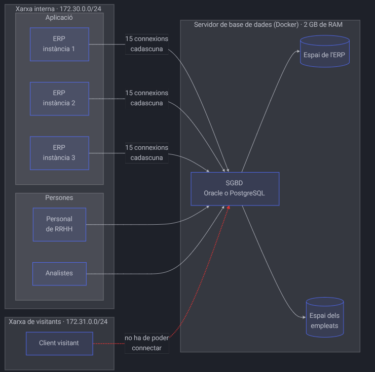

# CIPFP Mislata

**Centro Integrado Público de Formación Profesional Superior**

*artis superioris formatio integrata*

---

# Práctica 1: Instalación, configuración y control de acceso

**ASGBD: Administración de Sistemas de Gestión de Bases de Datos**

* **URL del curso:** [https://joapuiib.github.io/asix-asgbd/practiques/p1/](https://joapuiib.github.io/asix-asgbd/practiques/p1/)
* **Autor:** Joan Puigcerver Ibáñez ([j.puigcerveribanez@edu.gva.es](mailto:j.puigcerveribanez@edu.gva.es))
* **Licencia:** CC BY-NC-SA 4.0 (*Reconocimiento - NoComercial - CompartirIgual*)

---

## Enunciado

Eres el DBA de una empresa ficticia. La empresa tiene una aplicación de gestión (ERP) y un equipo de personas que trabajan directamente con la base de datos, y te encarga desplegar un único servidor que los atienda a todos, y controlar quién accede y qué puede hacer en ella. Lo harás con **Docker**, empleando **Oracle** o **PostgreSQL** (a tu elección).

Más abajo dispones de 8 requisitos que el servidor debe cumplir y una ampliación opcional. Los requisitos 1 a 6 abordan la instalación y la configuración del servidor, y los requisitos 7 y 8, el control de acceso. Cada uno indica la necesidad de la empresa, qué se debe cumplir y qué tienes que demostrar. No se indican qué ficheros ni qué parámetros debes modificar: eso lo debes descubrir y justificar tú.

---

## Escenario

El diagrama resume la estructura: quién se conecta al servidor, desde qué red, y el servidor de base de datos que debes desplegar.



### Esquema lógico de red y servicios

```text
+-------------------------------------------------------------+
| Red interna (172.30.0.0/24)                                 |
|                                                             |
|  [Aplicación]                                               |
|  +---------------------+                                    |
|  | ERP instancia 1     |---+ (15 conexiones)                |
|  +---------------------+   |                                |
|  +---------------------+   |                                |
|  | ERP instancia 2     |---+ (15 conexiones)                |
|  +---------------------+   |                                |
|  +---------------------+   |                                |
|  | ERP instancia 3     |---+ (15 conexiones)                |
|  +---------------------+   |                                |
|                            v                                |
|  [Personas]             +-----------------------------+     |
|  +---------------------+|  Servidor SGBD (Docker)     |     |
|  | Personal de RRHH    ||  (2 GB de RAM)              |     |
|  +---------------------+|                             |     |
|  +---------------------+|  • Espacio del ERP          |     |
|  | Analistas           ||  • Espacio de los empleados |     |
|  +---------------------+|                             |     |
|                         +-----------------------------+     |
+----------------------------------------^--------------------+
                                         |
+----------------------------------------|--------------------+
| Red de visitantes (172.31.0.0/24)      |                    |
|  +---------------------+               :                    |
|  | Cliente visitante   |···············X (no debe poder     |
|  +---------------------+                  conectar)         |
+-------------------------------------------------------------+
```

Las siguientes tablas detallan los datos del escenario:

### Aplicación

| Aplicación | Uso | Descripción |
| :--- | :--- | :--- |
| **ERP** | 3 instancias $\times$ 15 conexiones por instancia | Aplicación de gestión de la empresa (pedidos, facturas, existencias...). Se ejecuta 3 veces a la vez. Cada instancia abre hasta 15 conexiones simultáneas a la base de datos. Sus datos crecen mucho. |

### Personas

Además del ERP, varias personas se conectan directamente a la base de datos desde sus equipos en la red interna. Trabajan con los datos de los empleados (RRHH), que no pertenecen al ERP: son de tamaño reducido y estables.

| Grupo | Personas | Qué hacen |
| :--- | :--- | :--- |
| **Personal de RRHH** | 2 | Gestionan los datos de los empleados, incluyendo los salarios. |
| **Analistas** | 3 | Realizan informes con los datos del ERP y de los empleados, pero no pueden ver los salarios. La plantilla de analistas cambia con frecuencia. |

### Infraestructura

| Recurso | Valor | Descripción |
| :--- | :--- | :--- |
| **RAM** | 2 GB | Memoria total de la que dispone el servidor de base de datos. El contenedor no puede usar más. |
| **Red interna** | `172.30.0.0/24` | Red donde están el ERP y los equipos del personal. Es la única desde donde se puede conectar al servidor. |
| **Red de visitantes** | `172.31.0.0/24` | Otra red que alcanza físicamente al servidor, pero que no debe poder conectarse a él. |

---

## Requisitos

### 1. Despliegue reproducible

* **Necesidad:** Si el servidor se pierde, debe poder volver a crearse rápidamente y con los mismos datos.
* **Se requiere:**
  * El despliegue (imagen, redes, volúmenes y límites de recursos) debe estar descrito en un `docker-compose.yml`.
  * La versión del software debe estar fijada (nada de `latest`).
  * Las contraseñas y el resto de configuración sensible no se suben al repositorio.
  * Los datos del servidor, los del ERP y los de los empleados deben estar en volúmenes separados.
  * Todo el escenario debe poder montarse con el script `setup-env.sh` (ver *Script de despliegue*).
* **Demuestra que:** Puedes destruir el servidor, volver a crearlo, y los datos persisten.

### 2. Acceso restringido a la red interna

* **Necesidad:** Solo el ERP y el personal de la red interna pueden conectarse al servidor. Nadie más, ni siquiera desde otra red que llegue al servidor.
* **Se requiere:**
  * El servidor debe estar conectado a ambas redes (aplicación y visitantes).
  * El sistema gestor de bases de datos debe rechazar las conexiones que procedan de la red de visitantes. No vale que no haya ruta: el rechazo debe ser decisión del SGBD.
  * No se debe publicar ningún puerto en el host.
* **Demuestra que:** Un cliente en la red interna conecta y un cliente en la red de visitantes es rechazado. Abre un contenedor cliente en cada red para probarlo.

### 3. Memoria

* **Necesidad:** El servidor dispone de 2 GB de RAM y debe aprovecharlos bien, sin quedarse corto ni pasarse. Si el servidor intenta usar más memoria de la que tiene asignada el contenedor, Docker lo mata (OOM Killer).
* **Contexto:** Un SGBD no usa la memoria de una sola forma. Una parte es compartida por todo el servidor (por ejemplo, la memoria caché de datos que evita leer del disco). Otra se reserva por sesión o por operación (por ejemplo, para ordenar resultados o hacer combinaciones de tablas) y, por tanto, crece con el número de conexiones. Además, el sistema operativo y los procesos internos del propio servidor también necesitan memoria.
* **Se requiere:**
  * Identificar los parámetros de tu SGBD que controlan estas dos clases de memoria (la compartida y la asignada por sesión u operación).
  * Configurarlos con valores calculados, de manera que la suma, en el peor caso, quepa en los 2 GB y deje margen para el sistema operativo.
  * Justificar el reparto con un cálculo por escrito (qué reservas para cada elemento y por qué). El número de conexiones del requisito 4 influye en esto.
* **Demuestra que:**
  * Hay un parámetro de memoria que se puede modificar sin reiniciar el servidor: muestra el valor antes y después, consultando el servidor.
  * Hay otro que requiere reiniciarlo: modifícalo y muestra que el valor en uso no cambia hasta que reinicias.
* **Qué entregarás:** Una tabla con cada parámetro elegido, su valor, el cálculo que lo justifica y la salida del servidor que demuestre el valor activo.

### 4. Conexiones

* **Necesidad:** El servidor debe admitir todas las conexiones que el ERP y el personal puedan abrir a la vez, pero no más de las necesarias.
* **Se requiere:**
  * Calcular el número máximo de conexiones simultáneas a partir del escenario.
  * Justificar el valor (no tiene que ser exacto, pero sí defendible).
* **Demuestra que:** Cuando se supera el límite, el servidor rechaza la conexión y muestra el error correspondiente.

### 5. Almacenamiento

* **Se requiere:**
  * Que haya al menos 2 espacios de almacenamiento (*tablespaces*), uno para los datos del ERP y otro para los de los empleados, en volúmenes diferentes.
  * Que los datos de los espacios de almacenamiento se mantengan cuando se reinicia el contenedor.
* **Demuestra que:**
  * Conoces dónde se ubica físicamente cada espacio consultando el diccionario de datos.
  * Tras reiniciar el contenedor, los datos de ambos espacios siguen existiendo.

### 6. Trazabilidad

* **Necesidad:** Si alguien intenta conectarse sin permiso, debe quedar constancia, incluso aunque el contenedor sea destruido.
* **Se requiere:**
  * Los registros (*logs*) del servidor deben escribirse en un fichero en una ubicación persistente.
* **Demuestra que:** Los intentos de conexión denegados del requisito 2 aparecen reflejados en dicho fichero.

### 7. Cuenta de la aplicación

* **Necesidad:** El ERP debe acceder únicamente a sus propios datos, y un fallo o un ataque en la aplicación no debe poder modificar la estructura de la base de datos (DDL). Además, la aplicación no puede quedarse sin servicio de forma inesperada.
* **Se requiere:**
  * Los datos del ERP y los de los empleados pertenezcan, cada uno, a una cuenta propietaria (*owner*) propia, que nadie utilice para conectarse de forma habitual, y se guarden en su correspondiente espacio de almacenamiento (requisito 5).
  * El ERP se conecte mediante una cuenta diferente a la propietaria, que únicamente pueda consultar y modificar los datos del ERP (DML).
  * La cuenta del ERP no pueda abrir más conexiones de las requeridas por sus instancias (requisito 4).
  * La contraseña de la cuenta del ERP no caduque.
* **Demuestra que:**
  * La cuenta de conexión del ERP puede insertar datos, pero no puede crear ni eliminar tablas.
  * Cuando la cuenta del ERP sobrepasa su límite de conexiones, el servidor la rechaza.

### 8. Acceso del personal

* **Necesidad:** El personal de RRHH y los analistas se conectan directamente a la base de datos. Cada persona debe tener su cuenta propia, y la plantilla de analistas cambia con frecuencia: dar de alta o de baja a una persona no puede suponer revisar los privilegios uno a uno.
* **Se requiere:**
  * Cada persona tenga una cuenta nominal, con una contraseña que caduque como máximo cada 90 días.
  * Los privilegios se asignen a grupos de privilegios (roles), uno por perfil de puesto, y nunca directamente a las personas.
  * El personal de RRHH pueda consultar y modificar los datos de los empleados.
  * Los analistas puedan consultar los datos del ERP y de los empleados, pero **nunca los salarios**. Añade una columna de salario a los datos de los empleados si no la tuvieran.
* **Demuestra que:**
  * Un analista puede consultar los datos de los empleados, pero la consulta sobre el salario es rechazada por falta de privilegios.
  * Al incorporar un analista nuevo, basta con asignarle el rol de analistas para que pueda realizar las mismas consultas que el resto, sin otorgarle ningún privilegio directo adicional.
  * Al causar baja un analista, basta con retirarle el rol para que pierda todos sus privilegios.

### 9. Ampliación: Caída repentina (opcional)

* **Necesidad:** El servidor puede caerse en cualquier momento (un fallo eléctrico, por ejemplo) y no debe dejar los datos en un estado inconsistente.
* **Se requiere:**
  * El servidor esté configurado para volver a levantarse automáticamente si el proceso cae.
* **Demuestra que:**
  * Tras simular una caída repentina, una transacción confirmada (con `COMMIT`) se conserva y una transacción sin confirmar se descarta (*rollback*).
  * Existe una configuración que mejora el rendimiento de las confirmaciones a cambio de relajar la durabilidad: investígala e intenta reproducir un caso donde se pierda una transacción confirmada.

---

## Entrega

Entrega un único documento (`p1/README.md`) que explique todo el trabajo realizado en la práctica: las órdenes ejecutadas, la salida obtenida y por qué has tomado cada decisión (no solo el "cómo"). No existe una única solución válida: se valorará el razonamiento técnico y la justificación fundamentada en evidencias.

Las demostraciones deben estar respaldadas por consultas al diccionario de datos o por la salida directa de la consola del servidor, no por capturas de un archivo de configuración editado.

La práctica se validará oralmente: se te pedirá cambiar un parámetro o dar de alta a una persona en directo, y explicar por qué has escogido cada configuración.

### Tabla resumen

Al principio del documento incluye una tabla resumen que explique cómo has resuelto cada requisito y dónde se encuentra la evidencia dentro del documento:

| Requisito | Cómo se ha resuelto | Evidencia |
| :--- | :--- | :--- |
| **1. Despliegue reproducible** | *Resumen breve de la configuración* | *Sección o captura* |
| **2. Acceso restringido a la red interna** | | |
| **3. Memoria** | | |
| **4. Conexiones** | | |
| **5. Almacenamiento** | | |
| **6. Trazabilidad** | | |
| **7. Cuenta de la aplicación** | | |
| **8. Acceso del personal** | | |
| **9. Ampliación: caída repentina (opcional)** | | |

---

## Script de despliegue

La entrega debe incluir un script `p1/setup-env.sh` que monte todo el escenario de la práctica a partir de un clon limpio del repositorio: crear y arrancar los contenedores, aplicar la configuración y ejecutar los ficheros SQL necesarios (*tablespaces*, usuarios, roles, privilegios...).

### `p1/setup-env.sh`

```bash
#!/usr/bin/env bash
set -euo pipefail
cd "$(dirname "$0")"

### CONTENEDORES
# Crea/arranca los contenedores si es necesario y espera a que estén en estado saludable (healthy)
docker compose up -d --wait

### FICHEROS DE CONFIGURACIÓN
docker cp conf/...conf empresa-db:/var/lib/postgresql/data/...conf

### EJEMPLO DE EJECUCIÓN DE CONSULTAS SQL
docker exec -i empresa-db psql -U postgres < sql/consultas.sql
```

### `p1/docker-compose.yml`

```yaml
services:
  db:
    container_name: empresa-db
    image: postgres:16.4
    environment:
      #
    volumes:
      #
    healthcheck:
      # Comprobación por TCP: durante la inicialización el servidor temporal solo escucha por el socket
      test: ["CMD-SHELL", "pg_isready -h 127.0.0.1 -U postgres"]
      interval: 2s
      timeout: 5s
      retries: 30
      start_period: 10s
```

---

## Estructura del repositorio

Toda la información de esta unidad debe estar ubicada en el directorio `p1`, siguiendo esta estructura:

```text
ApellidoNombre-ASGBD/
├── README.md
├── docker-compose.yml       # general
├── .gitignore
└── p1/
    ├── README.md            # memoria técnica de la práctica
    ├── docker-compose.yml   # específico de la P1
    ├── setup-env.sh         # script de montaje automatizado
    ├── .env.example
    ├── conf/                # ficheros de configuración
    ├── sql/                 # ficheros con scripts y consultas
    └── img/
        ├── captura-1.png
        └── captura-N.png
```

---

## Entrega con GitHub

La entrega de esta práctica se debe realizar mediante GitHub:

1. Crea una etiqueta llamada `P1` en el último commit donde se encuentre la versión definitiva de la práctica:
   ```bash
   git tag P1
   ```
2. Publica la etiqueta en el repositorio remoto:
   ```bash
   git push --tags
   ```
3. Entrega en Aules el enlace al documento de la práctica en la etiqueta creada:
   `https://github.com/fpmislata-asix2-asgbd/ApellidoNombre-ASGBD/tree/P1/p1/README.md`

> *Este documento puede quedar desactualizado tras imprimirlo. Puedes consultar la versión más reciente en la página web.*
>
> *Antes de imprimir este documento, considera si es realmente necesario. Reduce el consumo de papel y ayuda a proteger nuestro entorno.*