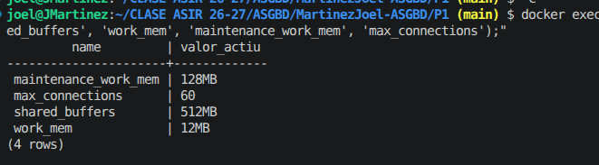
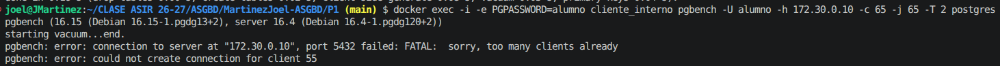
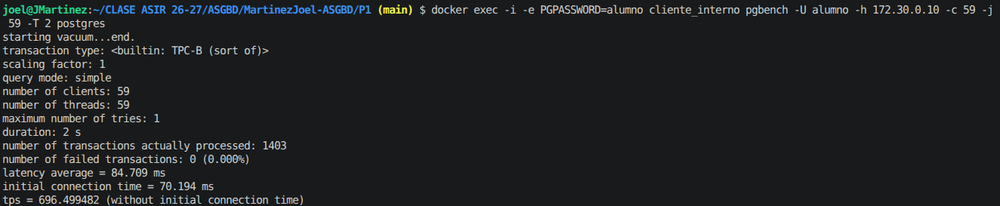

# PRACTICA 1
Este es el documento donde se explicará todo el trabajo relacionado con la práctica 1. 
## Tabla de resumen
|Requisitos  |Como se ha resuelto |Evidencia  |
|---------|---------|---------|
|1. Desplegación reproducible    |         |         |
|2. Acceso restringido a la red de la aplicación    |         |         |
|3. Memória    |         |         |
|4. Conexiones     |         |         |
|5. Almacenamiento     |         |         |
|6. Trazabilidad     |         |         |
|7. Cuenta de la aplicación     |         |         |
|7. Acceso del personal     |         |         |
|7. Ampliación: Caída repentina (opcional)     |         |         |

Utilizado postgres 16 por ser una versión estable y no usar una versión latest. 
Redes:
      ud1_interna:
        ipv4_address: 172.30.0.10/24
      ud1_visitantes:
        ipv4_address: 172.31.0.10/24
    Asignadas la .10 ya que las primeras IPs las suele utilizar docker.
    

credenciales en .env ocultado por .gitignore

se utiliza como clientes la misma imagen de postgres para evitar tener que instalar en otras imagenes el psql, ya que en postgres ya viene instalado. 

Se utiliza entrypoint: ["sleep", "infinity"] para evitar que inicializen  subase de datos

Se crea además un volumen de logs apuntando a /var/logs/postgresql para cumplir con el apartado 6

Limite conexiones de 60.

ERP: 3 instàncies × 15 connexions cadascuna = 45 connexions.   
Personal de RRHH: 2 persones = 2 connexions.  
Analistes: 3 persones = 3 connexions.  

## Requisito 3: Memoria
Asignado 2 GB al contenedor postgreSQL.

### Cálculo de memoria

**Shared buffers**: 512 MB

**maintenance_work_mem**: 128 MB

**work_mem**: 12 MB

|Parámetro  |Tipo memoria  |Valor  |Justificación  |
|---------|---------|---------|---------|
|Sistema operativo|SO|512 MB|Margen reservado para el kernel Linux del contenedor y procesos en segundo plano del SO.|
|shared_buffers|Memoria compartida|512 MB |25% de la RAM total (estándar óptimo en PostgreSQL). Espacio compartido para almacenar páginas de datos en caché.|
|maintenance_work_mem|Memoria por operación puntual de mantenimiento|128 MB|Memoria para mantenimientos (VACUUM, creación de índices). No compite con las consultas regulares.|
|work_mem|Memoria por operación|12 MB|Memoria máxima por operación de ordenación/agrupación.|

Total peor caso: $512\text{ MB (SO)} + 512\text{ MB (shared)} + 720\text{ MB (work)} + 128\text{ MB} = \mathbf{1872\text{ MB}} < 2048\text{ MB}$.
Se queda un margen de 176 MB libres.
### Salida del servidor
#### Comandos utilizados
docker exec -i empresa-db psql -U postgres -c "SHOW shared_buffers;"

docker exec -i empresa-db psql -U postgres -c "SHOW work_mem;"

docker exec -i empresa-db psql -U postgres -c "SHOW maintenance_work_mem;"

docker exec -i empresa-db psql -U postgres -c "SHOW max_connections;"

#### Verificación
docker exec -i empresa-db psql -U alumno -c "SELECT name, current_setting(name) AS valor_actiu FROM pg_settings WHERE name IN ('shared_buffers', 'work_mem', 'maintenance_work_mem', 'max_connections');"

## Requisito 4: Conexiones
El servidor debe admitir todas las conexiones necesarias para el ERP y el personal, pero no más de las necesarias.

En el paso anterior, junto al cálculo de memoria, ya calculamos las conexiones necesarias. 

- ERP: 3 instancias $\times$ 15 conexiones = 45 conexiones.
- RRHH: 2 personas = 2 conexiones.   
- Analistas: 3 personas = 3 conexiones.   
- Total nominal concurrente: 50 conexiones.   
- Total configurado en max_connections: 60 conexiones (dejando 10 slots de reserva y margen técnico para el superusuario/mantenimiento).   

### Prueba de conexión límite
Se prueba utilizando el comando pgbench para simular varias conexiones simultáneas. Hay que crear tablas de prueba para que funcione pgbench. 

#### 1. Crear las tablas de prueba de pgbench
docker exec -i -e PGPASSWORD=alumno cliente_interno pgbench -i -U alumno -h 172.30.0.10 postgres

#### 2. Lanzar la saturación de 65 conexiones
docker exec -i -e PGPASSWORD=alumno cliente_interno pgbench -U alumno -h 172.30.0.10 -c 65 -j 65 -T 2 postgres

